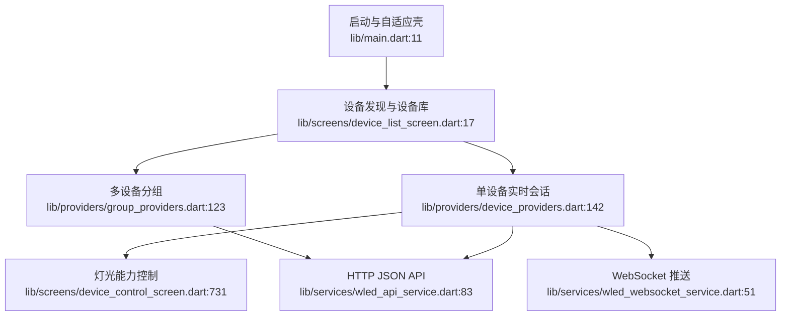

# W-Link 功能边界

审计范围：Flutter/Dart 应用层。原生 Siri/App Intents、平台构建脚本与商店发布流程不在本轮范围内。

## 1. 设备发现与设备库

- 入口：`lib/screens/device_list_screen.dart:17`、`lib/screens/device_discovery_screen.dart:12`
- 核心：`lib/services/mdns_discovery_service.dart`、`lib/providers/device_providers.dart:16-105`、`lib/models/wled_device.dart`
- 边界：发现、验证、添加、持久化、在线概览、App Group 同步。

## 2. 单设备实时会话与通信

- 入口：`lib/screens/device_control_screen.dart:23`、`lib/widgets/device_card.dart:13`
- 核心：`lib/providers/device_providers.dart:111-404`、`lib/services/wled_api_service.dart`、`lib/services/wled_websocket_service.dart`、`lib/services/wled_udp_service.dart`
- 边界：设备级 HTTP/WS 生命周期、轮询与重连、乐观更新、详情与卡片状态同步、错误与在线状态。

## 3. 灯光能力控制

- 入口：`lib/screens/device_control_screen.dart:731-1129`
- 核心：效果、调色板、快捷色、预设、分段、Nightlight、高级设置相关 screens/widgets/providers。
- 边界：把用户操作转换成 WLED JSON API payload，并把设备状态映射为可交互界面。

## 4. 多设备与应用壳

- 入口：`lib/screens/adaptive_shell.dart:17`、`lib/screens/groups_management_screen.dart:12`、`lib/screens/settings_screen.dart:11`
- 核心：`lib/providers/group_providers.dart`、`lib/providers/settings_provider.dart`、`lib/core/theme.dart`、`lib/core/l10n.dart`
- 边界：响应式导航、分组持久化与批量控制、主题/语言/重置、全局视觉系统。

## 当前高层关系

功能发现证据由只读 Phase 0 扫描获得，覆盖 `lib/` 全树、README、CLAUDE.md 与 pubspec.yaml。
