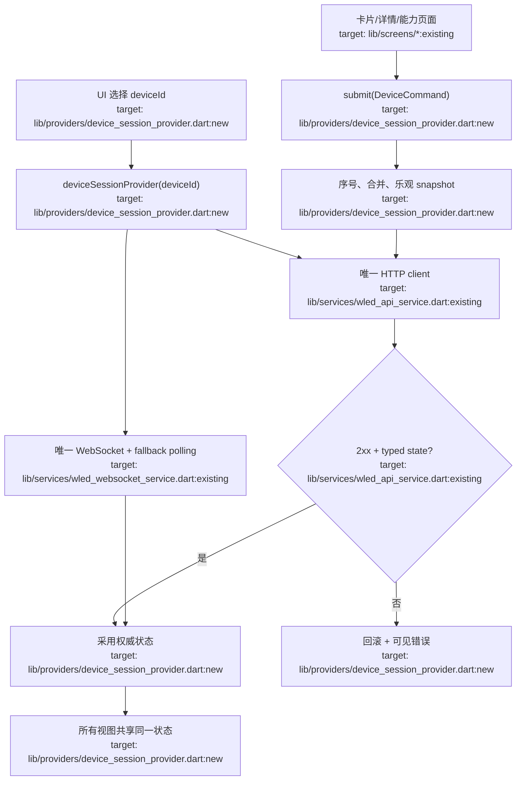

# 统一架构建议

## 1. 每设备一个会话

以 `deviceSessionProvider(deviceId)` 作为唯一设备状态源。Provider 内部持有一个 HTTP client、一个 WebSocket、一个轮询策略和一个 command queue；卡片与详情只选择不同视图，不再创建两套 session，也删除 `_syncToPeer`。

旧调用变化：

- `deviceStateProvider` 与 `deviceFamilyStateProvider` → 同一个 `deviceSessionProvider(deviceId)`。
- 卡片临时 `WledApiService` → `deviceSessionProvider(deviceId).notifier`。
- `currentDeviceIdProvider` 只表达导航选择，不拥有网络生命周期。

## 2. 一个设备写入入口

在设备 session notifier 提供单一 `submit(DeviceCommand command)`：

- 为请求分配递增序号；高频颜色使用“只保留最新值”的合并队列。
- 可乐观更新的命令保存 snapshot；成功采用 API 返回的权威状态；失败回滚并发布用户可见错误。
- 结构变更和资源变更明确声明成功后要刷新的资源，不允许页面自行 sleep/refresh。
- HTTP 层统一校验 2xx、JSON schema 与超时，返回 typed failure。

## 3. 一个主分段规则

模型层提供 `mainSegment` 与 `replaceSegmentById`。所有控制页和 payload 都使用真实 segment ID；默认目标取 `state.mainSeg`，不再使用 `seg.first` 或固定 0。

## 4. 收拢重复 UI 与持久化

- Nightlight 业务提取为一个 `NightlightEditor`；独立页面显示完整编辑器，设置面板只显示摘要并跳转。
- 效果与调色板共享选择列表壳，资源匹配和 payload 字段作为参数。
- `AppPageScaffold`、`AppDialog`、`AppBottomSheet` 统一 chrome，同时确保宽屏背景只有一个所有者。
- 所有 prefs 通过已注入的 `sharedPreferencesProvider`；每个领域保留自己的编码，但 mutation 统一返回 `Future` 并发布可观察状态。

## 5. UDP 取舍

当前 UDP 服务无消费者且 5 字节 DRGB 只描述一个 RGB 三元组。先从可达服务出口移除或标记实验性；只有在定义实时模式进入、续期、退出、LED 数量和权威状态回归后再接入，不与可靠 JSON 控制混用。

能力损失：无。UDP 暂不开放本来就不可达；去除双会话只减少重复网络负担。
