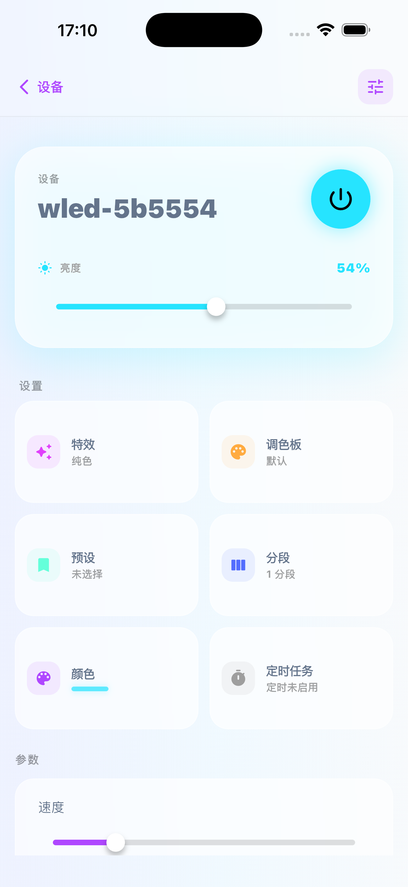
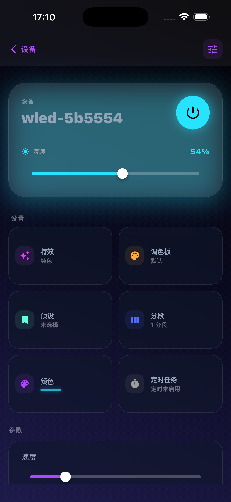

# W-Link - Modern [WLED](https://kno.wled.ge/) Controller

**[🇨🇳 中文](README.md) | 🇺🇸 English**

W-Link is a modern, minimalist [WLED](https://kno.wled.ge/) device control app built with Flutter. It aims to provide a smooth, intuitive user experience, making [WLED](https://kno.wled.ge/) LED strip management simple and elegant. *(Note: This project was developed with AI assistance, for learning and reference purposes)*

🌐 **Website**: [https://ainx.ink/](https://ainx.ink/)
🍎 **iOS / iPadOS**: Available on the App Store. Visit the website for the link.
🤖 **Android**: Download the APK from GitHub Releases or visit the website.
💻 **macOS / Windows**: Download the Universal Mac ZIP or Windows x64 ZIP from [GitHub Releases](https://github.com/fkueyu/W-Link/releases/latest). Extract the full Windows directory before running W-Link.exe. The Mac build is currently not notarized.

## ✨ Features

* **Auto Discovery**: Automatically discover [WLED](https://kno.wled.ge/) devices on your local network via mDNS, zero configuration.
* **Real-time Control**: Hybrid HTTP + WebSocket transport — millisecond response for power, brightness, color and effects, with real-time multi-client sync.
* **Optimistic UI**: Instant feedback regardless of network latency for a silky-smooth experience.
* **Responsive Layout**: Adaptive 800px breakpoint — push navigation on iPhone, list-detail two-pane on iPad / macOS.
* **Modern Design**: Glassmorphism visuals with subtle micro-interactions powered by `flutter_animate`.
* **Dark Mode**: Full system-level dark / light theme support, including an OLED-friendly pure-black "Deep Night" theme.
* **Siri Shortcuts**: Native iOS App Intents integration — control your devices from Shortcuts or Siri.
* **Defensive Programming**: Retry, graceful degradation, exponential-backoff WebSocket reconnect, and slow HTTP polling as a fallback.

## 🛠 Tech Stack

* **Framework**: Flutter (Dart SDK ≥ 3.10.4)
* **State Management**: [Riverpod 2.6](https://riverpod.dev/) (annotation-driven + hand-written StateNotifier mix)
* **Networking**: `http` (Keep-Alive / 5s timeout) + `web_socket_channel` (live push)
* **Discovery**: `multicast_dns` (mDNS) + `connectivity_plus` (network state)
* **Storage**: `shared_preferences` (devices and settings persistence)
* **UI Components**:
  * `flutter_animate`: Declarative animations
  * `flex_color_picker`: Professional color picker
  * `cupertino_icons`: iOS-style icons
* **Architecture**:
  * Feature-first layered architecture (`core` / `models` / `providers` / `services` / `screens` / `widgets`)
  * Code Generation (`riverpod_generator`, `json_serializable`)
* **Native iOS**: Fully off CocoaPods — Swift Package Manager only. Bridges to App Intents via `MethodChannel('flux/app_groups')` and an App Group shared device list.

## 📸 Screenshots

| Light Mode                                 | Dark Mode                                |
| :----------------------------------------: | :--------------------------------------: |
|   |   |

## 🚀 Getting Started

### Prerequisites

* Flutter SDK ≥ 3.10.4 (Dart SDK ≥ 3.10)
* Xcode 16+ (for iOS / macOS builds)
* Android Studio / Android SDK (for Android builds)

### Installation

1. **Clone the repository**

    ```bash
    git clone https://github.com/fkueyu/W-Link.git
    cd W-Link
    ```

2. **Install dependencies**

    ```bash
    flutter pub get
    ```

3. **Run code generation (required)**
    The project uses code generation for JSON serialization and Riverpod providers. Re-run after editing models or `@riverpod`-annotated files.

    ```bash
    dart run build_runner build -d
    # Watch mode
    dart run build_runner watch -d
    ```

4. **Run the app**

    ```bash
    flutter run
    # Target a specific device
    flutter run -d <device-id>
    ```

## 📂 Project Structure

```text
lib/
├── core/          # Theme, constants, extensions, l10n, utilities
├── models/        # WLED JSON API DTOs (type-safe)
├── providers/     # Riverpod providers (business state)
├── screens/       # Pages (incl. adaptive_shell responsive root)
├── services/      # HTTP / WebSocket / mDNS / AppGroups / Storage
├── widgets/       # Reusable UI (GlassCard, BouncyButton, SmartSlider, ...)
└── main.dart      # Entry point (injects synchronous SharedPreferences)
```

## 📖 Docs

The `docs/` folder ships full Chinese project documentation (not bundled in the app, but the source of truth for architecture decisions and release notes):

* [`docs/架构设计.md`](docs/架构设计.md) — Design principles, tech choices, layering rationale
* [`docs/贡献指南.md`](docs/贡献指南.md) — Code style and PR conventions
* [`docs/任务清单.md`](docs/任务清单.md) — Historical roadmap and completed items
* [`docs/帮助与支持.md`](docs/帮助与支持.md) — End-user FAQ
* [`docs/应用商店元数据.md`](docs/应用商店元数据.md) — App store metadata
* [`docs/隐私政策.md`](docs/隐私政策.md) — Privacy policy

## 🤝 Contributing

PRs are welcome! Please ensure your code follows `flutter_lints` standards and a "No Fluff" coding philosophy. See [`docs/贡献指南.md`](docs/贡献指南.md).

## 📄 License

This project is open-sourced under the MIT License.

## ☕ Buy Me a Coffee

If this project helps you, feel free to buy the author a coffee!

<p align="center">
  
  &nbsp;&nbsp;&nbsp;&nbsp;
  
</p>

<p align="center">
  <sub>WeChat Pay &nbsp;&nbsp;&nbsp;&nbsp;&nbsp;&nbsp;&nbsp;&nbsp;&nbsp;&nbsp;&nbsp;&nbsp;&nbsp;&nbsp;&nbsp;&nbsp;&nbsp;&nbsp;&nbsp;&nbsp;&nbsp;&nbsp;&nbsp;&nbsp; Alipay</sub>
</p>
