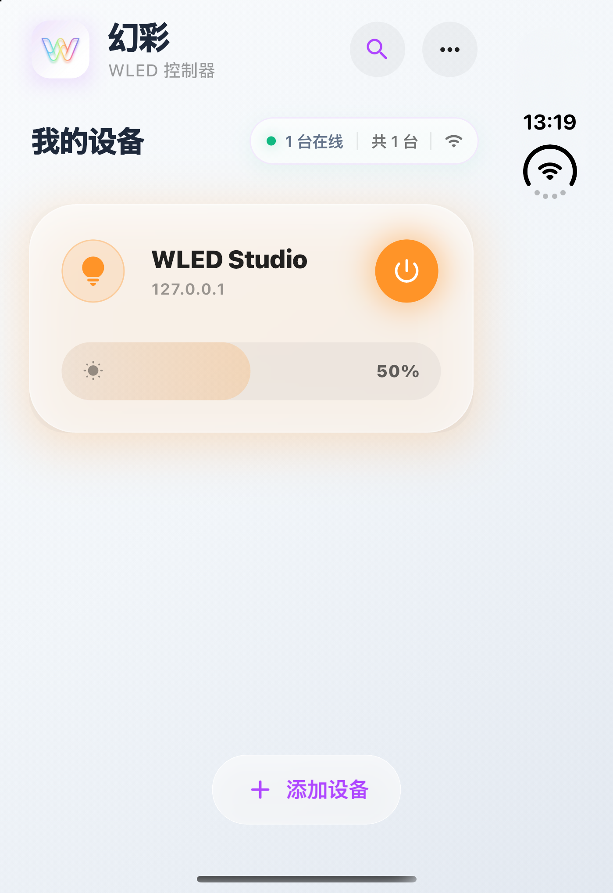
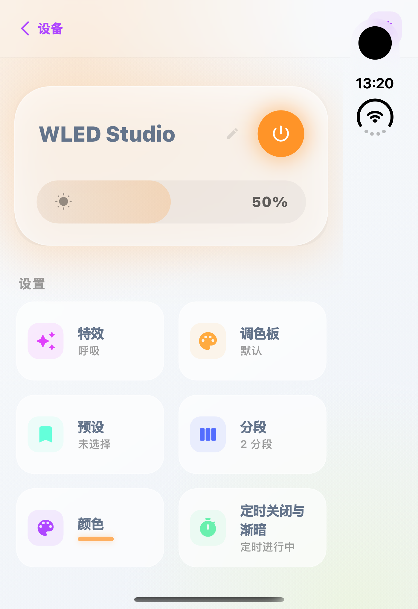
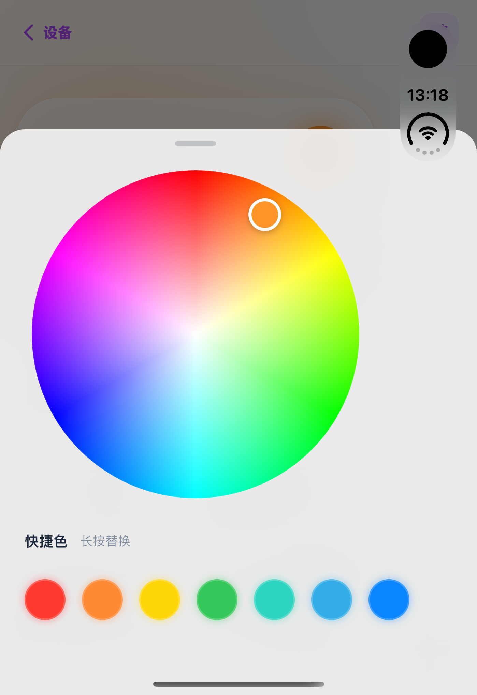
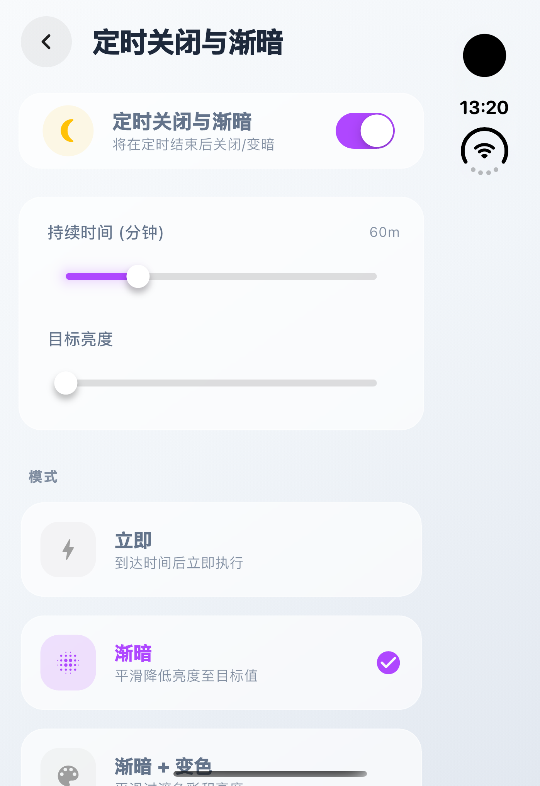
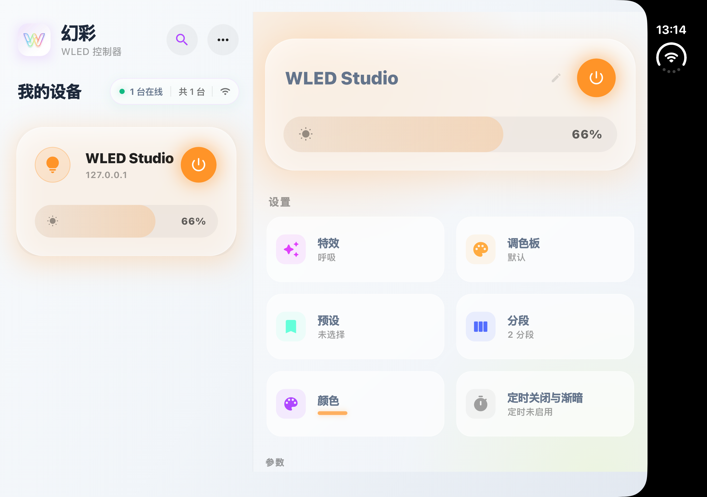

# iPhone Duo 模拟器验证（2026-10-24）

上一批（[2026-10-17 Duo 视觉验证](../2026-10-17-Duo%20视觉验证/验证记录.md)）的结论里留了三条「没有像素证据」：
短而宽的姿态、内屏 951×669、`_kContentMaxWidth = 680` 是否合适。本批在**真正的 iPhone Duo 模拟器**
（iOS 27.1）上跑同一个构建，把能证的和不能证的分开。

结论先写：**外屏（466×678）全部通过**，并且发现一个此前不知道的硬约束——**iOS 在外屏右侧留了 84pt
保留区**，所以外屏的可用内容宽度只有 **382pt**，比 P0 测试档里最窄的 393pt 还窄 11pt。

## 1. 怎么跑起来的（可复现）

| 步骤 | 命令 / 事实 |
| --- | --- |
| 设备 | `xcrun simctl list devices` → `iPhone Duo (36AA1013…) (Booted)`，runtime **iOS 27.1** |
| 构建 | `FLUTTER_XCODE_ONLY_ACTIVE_ARCH=YES FLUTTER_XCODE_ARCHS=arm64 flutter build ios --simulator --debug -t tool/shots/main.dart` |
| 安装 | `xcrun simctl install <udid> build/ios/iphonesimulator/Runner.app` |
| 假设备 | `python3 tool/shots/mock_wled.py 8099 /tmp/mock_wled.log`（本批新增，见 §5） |
| 注入点击 | 指令写进容器 `tmp/shots_cmd.txt`（`<seq> tap <x> <y>`），App 用 `GestureBinding.handlePointerEvent` 执行 |
| 取图 | `xcrun simctl io <udid> screenshot --display=<port-uuid> <file>` |
| 姿态 | DeviceHub 设备窗口里的 `Closed` / `Partially Open` / `Open` 三个按钮（AX 可点，见 §6） |

### 构建这一步在本机是红的，与产品代码无关

```
Binary …/build/ios/Debug-iphonesimulator/Flutter.framework/Flutter does not contain architectures "arm64 x86_64"
lipo -info: Architectures in the fat file: … are: x86_64 arm64
```

`flutter_tools/src/build_system/targets/darwin.dart:80` 把 arch 列表拼成
`lipo <file> -verify_arch arm64 x86_64`，而 `lipo` 只接受**一个**输入文件，
于是报 `lipo: -verify_arch requires exactly one input file`——**双 arch 的模拟器构建必失败**。
只要让它变单 arch 就恢复正常：

```bash
FLUTTER_XCODE_ONLY_ACTIVE_ARCH=YES FLUTTER_XCODE_ARCHS=arm64 flutter build ios --simulator …
```

`flutter clean` 之后重建仍然失败，所以这不是脏产物，是工具链本身的问题。

## 2. 外屏（合上）：466×678，但只有 382×644 可用

从 Dart VM Service 读到的是**运行中的真实约束**，不是推算：

```
view size: Size(1398.0, 2034.0) physical  →  466 × 678 logical @3x
MediaQuery … padding: EdgeInsets(0.0, 0.0, 84.0, 34.0)
```

- **右侧 84pt**：竖排状态栏 + 摄像头所在的那一条。截图里右边缘那块黑底、时钟与 WiFi 竖着排的就是它。
- **底部 34pt**：home indicator。
- 所以内容区是 **382 × 644**。P0 的测试档是 393×600 与 480×600——**真机比最窄那档还窄 11pt**。

App 的应对是**对的**：所有内容都收在 382pt 里（见 `01`、`02`），没有一条内容跑进那 84pt。




## 3. 逐项复核（外屏）

| # | 上一批的结论 | 本批实测 | 判定 |
| --- | --- | --- | --- |
| 1 | 瓦片 84→92pt 修掉「中文两行标题溢出 4.6pt」 | `02`：「定时关闭与渐暗」折两行、底部**无** overflow 条纹 | ✅ 成立 |
| 2 | 顶部玻璃条与内容不再重叠 | `02`：返回栏与首屏卡片之间留白正常 | ✅ 成立 |
| 3 | 色盘边长按高度预算推导（上限 320） | `03`：轮盘实测约 **317pt**，弹层自适应、无裁切 | ✅ 成立 |
| 4 | 色盘弹层要有玻璃模糊 | `03`：弹层背后页面被模糊，无「透字」 | ✅ 成立 |
| 5 | 弹窗外壳可滚（R1） | `04`：定时关闭页开关打开后内容超出一屏，可滚到底 | ✅ 成立 |
| 6 | 快速长列表不溢出 | `05`：120 个特效的列表正常滚动 | ✅ 成立 |




`03` 里快捷色条**第 8 个被裁掉一半**是**设计如此**：那是横向 `ListView`，被裁的半个就是"还能往右滑"的提示
（`lib/widgets/color_picker_sheet.dart` 的 `ListView.separated`，`scrollDirection: horizontal`）。**不是溢出**。

## 4. 内屏：只拿到过渡帧，稳态没有像素证据

内屏的真实尺寸从渲染树读到是 **951×669**（`2853×2007` @3x），与 P0 测试档一致。

但**稳态截图没拿到**：设备窗口在我切姿态时被 DeviceHub 合并成了 Hub 窗口，之后 AX 树里再也找不到
`Closed / Partially Open / Open` 三个按钮；退出 DeviceHub 时它**顺带把所有模拟器都关了**，
而单纯 `simctl boot` 不会重新出现设备窗口（窗口要人点开）。

现有的一张是**姿态切换过程中的过渡帧**（`06`）：



这一帧里 App 拿到的是 **871×669**（= 951 − 80，过渡中窗口比屏幕少 80pt，右侧那条黑边就是这么来的），
但已经能证明一件关键的事：**宽 ≥800 断点成立、两栏布局在 Duo 内屏上真的会出现**，左栏设备列表 + 右栏控制页，
卡片与瓦片都没有溢出。

> ⚠️ 这条很容易误判：姿态切换的过渡期里窗口会先给出 `466→386`、`951→871` 的中间尺寸，持续约 2–6 秒。
> 我在 13:16 拍的几张截图就是这个状态（内容只占屏幕左侧约 4/5，右边全黑），
> **看上去完全像布局缺陷**，其实是过渡帧。验收流程必须**等 ≥6 秒再截图**。

## 5. 本批新增的工具

`tool/shots/mock_wled.py`：给 `tool/shots/main.dart` 提供一台假 WLED。
上一批的假设备是临时写的、没有入库，这次补上，并加了 **`/ws` WebSocket 握手 + 每 2 秒推送 state**。

> 没有 `/ws` 时 App 会一直显示「连接异常」——因为在线判定挂在实时通道上。
> 这也是本批第一次跑起来时踩到的：`/json` 明明返回 200，界面却是灰的。

实现 `/json`、`/json/state`（GET/POST）、`/json/info`、`/json/eff`、`/json/pal`、`/json/fxdata`、`/presets.json`、`/ws`。
POST 会真的改内存里的 state，所以"点开关、拖亮度"截出来的图反映的是设备回报的状态。

## 6. 姿态是怎么切的（给下一个人）

DeviceHub（Xcode 27.1 里取代了 `Simulator.app`）的设备窗口，辅助功能树里有这些按钮：

```
AXButton desc=Home / Screenshot / Record / Rotate Right
AXButton desc=Closed / Partially Open / Open      ← 折叠姿态
```

本批用 `AXUIElementPerformAction(…, kAXPressAction)` 直接按，不需要鼠标。两点注意：

1. **窗口标题会变**：设备窗口叫 `iPhone Duo – iOS 27.1`，Hub 窗口叫 `Device Hub`；按之前先确认窗口标题。
2. **退出 DeviceHub 会关掉所有模拟器**，再 `simctl boot` 也不会自动给窗口。

`simctl` 本身**没有** fold/rotate 子命令：`simctl help`、`CoreSimulator`、`SimulatorKit` 里都没有相关字符串。

## 7. 仍然没有验证到的

1. **内屏 951×669 的稳态截图**（见 §4）。两栏成立已证，但 951 下的边距与右栏宽度没有像素证据。
2. **折叠中间态**（Partially Open / 帐篷）、**旋转**（Rotate Right）：同样卡在设备窗口上。
3. **软键盘弹出**后的弹窗位置：模拟器默认接硬件键盘，软键盘不弹；需要 `Toggle Software Keyboard`。
4. **右侧 84pt 保留区在内屏是否存在**：只在外屏读到 `padding.right = 84`，内屏没读到（渲染树显示 951 全宽）。
5. 深色模式、Dynamic Type：本批全部是浅色 + 默认字号。

## 8. 对 P0 判据的影响

**不需要改产品代码**。真机 382pt 比测试档 393pt 窄 11pt，而 393 档没有溢出、真机也没有溢出，
说明那 11pt 的余量本来就在（瓦片高度按字号推导，不是按宽度定值）。

**测试档补了一档**：`test/screens/duo_postures_test.dart` 的 `kDuoPostures` 新增
`'外屏-真实可用 382x644'`（= 466×678 减去右侧 84pt 保留区与底部 34pt）。
这一档会跟着矩阵跑遍「色盘不溢出 / 弹窗不超屏 / 控制页不溢出」三组用例。
以后有人把间距调大 12pt，用例会红，而不是等到真机上才发现。

## 9. 复现清单（下一个人照着做）

```bash
# 1. 假设备
python3 tool/shots/mock_wled.py 8099 /tmp/mock_wled.log &

# 2. 构建（必须带单 arch 变量，否则 lipo 报错）
FLUTTER_XCODE_ONLY_ACTIVE_ARCH=YES FLUTTER_XCODE_ARCHS=arm64 \
  flutter build ios --simulator --debug -t tool/shots/main.dart

# 3. 装 + 起
xcrun simctl install <duo-udid> build/ios/iphonesimulator/Runner.app
xcrun simctl launch <duo-udid> ink.ainx.flux

# 4. 切姿态（先确认窗口标题是 iPhone Duo）
#    press <window> "Closed" | "Partially Open" | "Open"
# 5. 等 ≥6 秒，再截图
xcrun simctl io <duo-udid> screenshot /tmp/shot.png
```
